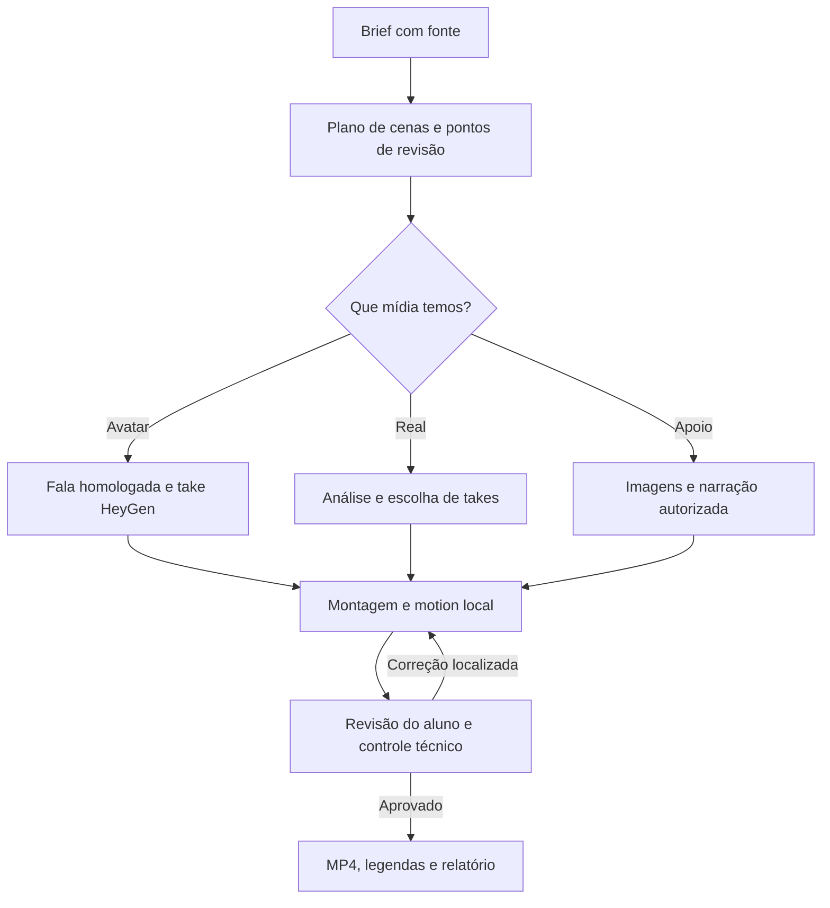

# Pipeline e ferramentas

## Fluxo executável



Cada produção tem slug e pasta em `producoes/`. Guarde `brief.md`, `fontes.md`, `roteiro-editorial.txt`, `roteiro-falado.txt` quando houver, `storyboard.md`, `plano.json`, `estado.json`, insumos, versões e pasta de entrega. Para cada afirmação crítica, registre texto, dono institucional, fonte, modalidade, vigência, data de conferência e passagem. A planilha de acervo e o relatório de QA ficam juntos.

O `estado.json` guarda etapa, hash de roteiro/perfil, IDs de insumos, versão de edição e, quando houver, ID do job HeyGen e estado do consumo. Use um único responsável pelo envio do job e pela escrita do estado. Em interrupção, retome pelo job/arquivo existentes. Uma mudança na voz, roteiro falado ou modelo invalida o bruto relevante. Motion, enquadramento, som, legenda e CTA reclamam só o trecho afetado e as verificações dependentes. Escolha pasta de revisão nova quando substituir composição ou export. Registre decisões objetivas para que outro Claude Code consiga continuar.

## Ferramentas avaliadas

| Ferramenta | Adoção | Justificativa e teste |
| --- | --- | --- |
| [HyperFrames](https://github.com/heygen-com/hyperframes) | Motor de motion para o piloto, Apache-2.0, local | Composições HTML com timeline explícita, checagem, prévia e render. Há um exemplo original de prática extensionista. Fixe versão e lockfile, browser e fontes, e use dependências locais. Cloud render fica fora. |
| [FFmpeg / ffprobe](https://ffmpeg.org/documentation.html) | Base do pipeline | Probe, corte preciso, normalização, legendas, encode, verificação e comparação de loudness. Leia a licença do build e dos codecs se for redistribuir binário. Trabalhe com intermediários e originais preservados. |
| [Concat](https://github.com/jub0t/Concat) | Comparação para operação humana e automação local | Editor alternativo ao CapCut, beta, AGPL-3.0-or-later e scriptável via API local/MCP. Pode ser útil para ajustes de timeline. Teste no Windows 3 casos: reabrir edição após mover pasta, 9:16 com legenda e export fiel de cor/áudio. Depois teste render em lote e round-trip quando o formato real suportar. A maturidade do piloto depende desse ensaio, não da lista de recursos. O pipeline principal usa HyperFrames e FFmpeg. |
| [Kdenlive](https://docs.kdenlive.org/en/getting_started/introduction.html) / [MLT](https://www.mltframework.org/) | Contingência de edição humana | Projeto editável, correção fina e revisão fácil. Valide a exportação de efeitos e dados antes de usar `melt` como renderer. |
| [OpenCut](https://github.com/OpenCut-app/OpenCut) | Observação | Editor MIT. O repositório principal descreve a reescrita com MCP, API e headless no plano de desenvolvimento. O modo clássico é uma rota de avaliação manual. Valide arquivo original, legenda, cor e export local no PC antes de usar. |
| [Blender](https://www.blender.org/) | Cena especial | 3D real, câmera, profundidade, iluminação e render local. Use quando uma ação precisa de parallax ou objetos. Padronize alfa, color management e pipeline de composição. |
| [faster-whisper](https://github.com/SYSTRAN/faster-whisper) / [WhisperX](https://github.com/m-bain/whisperX) | Transcrição local e alinhamento sob demanda | Comece em pt com modelo multilingual e VAD opcional. CPU com int8 no piloto. WhisperX para precisão temporal quando o modelo de alinhamento pt e hardware passarem. Revise siglas, nomes e texto. |
| [PySceneDetect](https://github.com/Breakthrough/PySceneDetect) / [OpenTimelineIO](https://github.com/AcademySoftwareFoundation/OpenTimelineIO) | Sob demanda | Inventário de cortes e troca de metadados entre ferramentas. Verifique suporte do adaptador a efeitos, áudio e legendas. |
| [Remotion](https://www.remotion.dev/docs/license/pricing) | Fora da base do piloto | Licença comercial depende da situação da organização, volume e modalidade de uso. Critérios visuais prevalecem sobre o motor. |
| [RTK](https://github.com/rtk-ai/rtk), [Context Mode](https://github.com/mksglu/context-mode), [Docling](https://github.com/docling-project/docling), [Repomix](https://github.com/yamadashy/repomix) | Contexto seletivo, opcionais do MD | Use RTK só se logs repetidos justificarem, Docling para extrair trechos de PDFs institucionais. Context Mode e Repomix entram após medir necessidade. Evite compactação em textos de regras, tabelas de pronúncia ou decisões críticas. |

Curadoria do MD anexado: reaproveitar teste de relevância, prova, clareza, CTA e economia por leitura seletiva. O fluxo de vídeo não precisa rodar em agenda. Registros pequenos, contato de quadros, trechos curtos e cache por hash evitam que cada agente absorva mídia ou logs brutos. Não instale em lote os repositórios do radar. Ferramentas de agentes extras, vídeo generativo, avatares em tempo real, armazenamento externo de memória e observabilidade entram apenas mediante hipótese clara e benefício medido. Montagem e composição usam acervo interno, FFmpeg e HyperFrames.

## Instalação e prova local

- Python 3.10+ e FFmpeg moderno com ffprobe, libx264, AAC e libass para legenda. No Windows, instale Git e Python pelo canal oficial, e FFmpeg por build recomendado no [site oficial](https://ffmpeg.org/download.html). Confirme PATH reabrindo o terminal. Em Linux/macOS use o gerenciador local confiável.
- Opcional para motion HTML: Node 24 LTS, Chrome/Chromium e `npm ci`. Use `npm run motion:check`, `npm run motion:preview` e `npm run motion:render` para o exemplo. O comando de render grava `motion-pratica.mp4` na raiz. O exemplo é um insert gráfico silencioso que entra como um dos clipes da montagem.
- Transcrição depois de o piloto básico rodar. Crie ambiente virtual local e instale `faster-whisper` a partir do projeto oficial. Valide pesos, espaço em disco e processamento local. Pré-baixe o modelo do repositório oficial quando a TI exigir execução offline.
- `python scripts/studio.py doctor` verifica ferramentas principais. `inspecionar` lê formato e streams. `roteiro` resolve triagem inicial da fala. `montar` aplica o plano de cortes e entrega MP4 e legendas quando fornecidas. `validar` mede o master distribuído e gera estado técnico com código de saída. Para roteiro real, a timeline deve incluir todos os cortes de fala e imagens. Use a locução editada como `audio_final` para manter narração contínua sob inserts.
- Video real: mantenha voz da fonte ou use mix com a mesma voz. Para mover entre takes, aplique J/L-cut em ferramenta de edição ou mixer de áudio e passe o WAV final com a duração indicada em `plano.json`. B-roll sem fala pode entrar com `mutar`. Perfil HDR, degradação forte ou VFR avariado pedem preparo controlado e validação de cor.
- Não dê permissão ampla a ganchos e ferramentas de terceiros. Instale sob controle da TI e mantenha versão fixa. Assets do episódio devem usar somente permissões necessárias.

[HyperFrames CLI](https://github.com/heygen-com/hyperframes/blob/main/docs/packages/cli.mdx) · [Claude Code Skills](https://code.claude.com/docs/en/skills) · [Subagentes](https://code.claude.com/docs/en/sub-agents) · [Filtros FFmpeg](https://ffmpeg.org/ffmpeg-filters.html)

### Vinheta local

Para a assinatura final em 1,4 s, use o SVG institucional aprovado ou PNG transparente equivalente. O arquivo fica no acervo local e é copiado para uma pasta ignorada pelo Git. Fundo claro, marca sem deformação e primeiro frame com a marca visível. Confira a variante da assinatura com Marketing. Para compor sobre fundo escuro, use arte com contraste aprovado. A vinheta é silenciosa, pronta para receber o toque opcional do Grupo.

```bash
npm run motion:check -- encerramento acervo/marca/logo-grupo.svg
npm run motion:render -- encerramento acervo/marca/logo-grupo.svg
```

A saída `motion-encerramento.mp4` entra como último clipe da montagem. O CTA aparece antes dela.
