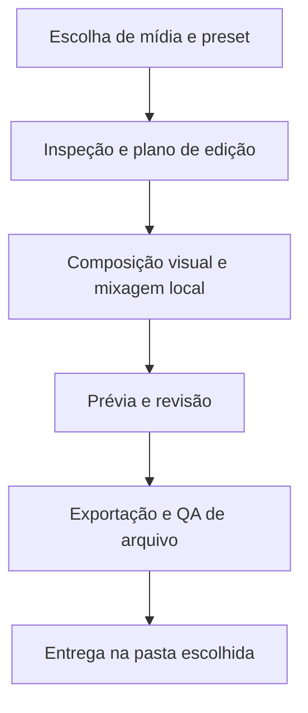

# Estúdio de edição para Windows

Para saber o que foi implementado depois deste levantamento consulte o [estado do projeto](estado.md) e as [instruções do piloto Windows](../../desktop/README.md). A arquitetura Tauri abaixo é uma proposta para uma versão de distribuição.

Pesquisa de produto e arquitetura · 19 de novembro de 2026. A meta do primeiro lançamento é transformar um vídeo e, opcionalmente, uma locução já produzidos em uma prévia editada e um MP4 revisado. O estúdio local cuida do acabamento. Os guias de HeyGen e Higgsfield ajudam o operador a preparar o bruto fora do aplicativo.

## Estado inicial observado antes das mudanças de 19/11

O repositório já tem um montador CLI em `scripts/studio.py`, composições HyperFrames em `motion/`, um roteiro de exemplo e QA técnico. A inspeção do código encontrou três limites que explicam por que a demonstração técnica anterior não garantia qualidade de edição:

- A montagem atual concatena clipes. A composição de prática entra como um clipe de tela cheia. Não há camada de motion sobre o rosto, mudança de layout simultânea entre apresentador e arte, nem transições por frase. Isso exige direção e uma composição composta, especialmente se a orientação é manter o apresentador visível.
- O campo `audio_final` substitui todas as faixas da montagem. Ele espera uma mixagem já pronta, quase da mesma duração da imagem. Não alinha fala, não mistura musicalmente, não corrige fonética e não faz lip-sync. Anexar um MP3 válido sozinho não entrega nenhuma dessas coisas.
- O validador confere formato, duração, decodificação e loudness em um perfil 9:16. Não avalia a dicção da voz, a boca, a adequação do roteiro nem o acabamento dos planos. A captura de saída do FFmpeg só chega ao fim do subprocesso, por isso ainda não existe barra ao vivo. Não há perfil de exportação 16:9 neste montador.

O caminho mais rápido para as amostras é reaproveitar o corte e o QA testados, montar as camadas que faltam em HyperFrames e usar um editor local para corrigir o que ainda não tem preset. A janela do Windows entra depois que o fluxo de edição sobreviver a arquivos reais.

## A sequência da operação

| Etapa | Tela e ação | Resultado visível |
|---|---|---|
| Projeto | Escolher vídeo MP4 importado do HeyGen/Higgsfield ou arquivo de câmera. Arrastar o arquivo ou usar o seletor do Windows. Escolher 9:16 ou 16:9 com a regra de vinheta explícita. | Miniatura, duração, resolução e áudio presente ou ausente. |
| Direção | Escolher uma identidade em cartões com **um trecho real de prévia** por identidade. O padrão é o preset homologado do CX. Avançado só quando necessário. | Mostra o mesmo material sob a composição escolhida e dá uma noção de legibilidade. |
| Voz | Preservar voz do vídeo por padrão quando houver áudio. Opções para substituir por MP3/WAV como narração ou usar vídeo sem fala. Apresentadora e apresentador são os dois perfis planejados. | Escuta A/B de 5–8 s. Registre a origem de cada perfil e sua autorização no acervo restrito. |
| Prévia | Montar amostra curta. Observar o trecho com boca em foco, legenda, motion de uma fala e vinheta correspondente. | Player local com reprodução e som. Se houver incompatibilidade de fala, expor o trecho que precisa de correção antes de exportar. |
| Exportação | Escolher pasta de destino e exportar. | Prévia e progresso mensurável. Depois, caminho para MP4, SRT/VTT quando houver, e aviso de revisão humana. |

O seletor de perfis associa o trabalho a um avatar e uma voz homologados. O avatar precisa já estar no vídeo importado. Se a pessoa selecionar outro perfil, o estúdio pode orientar a exportação do novo bruto seguindo o guia do provedor. Trocar a face ou a voz articulada dentro de um MP4 existente exigiria outro pipeline de geração e revisão.

Se houver diferença entre os dois anexos de encerramento, associar por formato só depois de identificar a dimensão nativa e conferir a versão autorizada. Se os dois forem do mesmo formato, deixar o operador escolher a vinheta aprovada correspondente ao canal e criar um novo arquivo no outro formato a partir de arte oficial. Em cada entrega, reserve o tempo da vinheta desde o roteiro, confira aspecto, marca, campo seguro, enquadramento, faixa original e o fim da legenda. O projeto mantém marca, takes e locuções aprovados fora do repositório público.

## Referências de experiência

| Referência consultada | Decisão aplicável ao estúdio | Verificação |
|---|---|---|
| Apple Human Interface Guidelines, Motion e Progress Indicators | Movimento breve acompanha o estado real. Um fundo com gradiente azul reage discretamente ao ponteiro somente na prévia/processamento. A interface continua legível com movimento reduzido. | Ctrl/Tab e teclado executam todo o fluxo. Com movimento reduzido, nenhuma dependência de parallax ou animação para informar a etapa. [Motion](https://developer.apple.com/design/human-interface-guidelines/motion) · [Progress Indicators](https://developer.apple.com/design/human-interface-guidelines/progress-indicators) |
| Vercel Geist Colors | Interface original com base neutra quente, um azul institucional de ação, superfícies e bordas de baixa ênfase, estados que combinam rótulo e cor. Use o azul do manual do Anchieta depois de conferência. | Contraste mínimo 4,5:1 para texto normal e 3:1 para texto grande. Testar Windows a 100%, 125% e 150%, foco visível, baixa visão e janela pequena. [Geist Colors](https://vercel.com/geist/colors) · [WCAG 2.2](https://www.w3.org/WAI/WCAG22/Understanding/contrast-minimum.html) |
| Higgsfield, primeira geração | Agrupar entrada principal, escolha visual, configuração e ação em sequência. Uma coluna de edição junto da prévia quando houver espaço. Exponha só decisão que a pessoa pode tomar no ponto atual. | Duas pessoas do CX conseguem abrir a mesma mídia, identificar o áudio usado, requisitar prévia, cancelar e encontrar a saída. Cronometrar sem coaching e registrar onde hesitaram. [Guia oficial Higgsfield](https://higgsfield.ai/creator-hub/help-center/getting-started/how-do-i-create-my-first-generation) |

Começar com uma janela funcional e duas propostas de acabamento sobre o mesmo fluxo. Aprovar primeiro um rascunho estático em 1280×800, depois testar carregamento, seleção e prévia com mídia real. O painel de processamento usa rótulos úteis como “Conferindo seus arquivos”, “Montando a prévia”, “Aplicando motion”, “Exportando MP4” e “Validando o arquivo” quando essas etapas existirem. Sem feed, galeria de terceiros, biblioteca online, login obrigatório, parâmetros de edição avançada ou conta nova no primeiro ciclo. O estilo dos vídeos é independente do estilo da janela.

## Arquitetura e prova antes do instalador

| Alternativa | Quando usar | Custo técnico ou condição |
|---|---|---|
| CLI atual + HyperFrames local | Amostras e bancada, recomendação imediata | Já existe integração inicial. Adicionar composição em camadas e QA por trecho. O Studio do HyperFrames permite editar e pré-ver as composições enquanto a interface própria ainda está em desenvolvimento. [CLI HyperFrames](https://github.com/heygen-com/hyperframes/blob/main/docs/packages/cli.mdx) |
| Tauri 2 + TypeScript/Vite e worker local | Recomendação para o aplicativo Windows após prova de integração | WebView2 para a interface. Rust valida IPC, organiza arquivos e gerencia execução. O worker reaproveita a lógica Python/FFmpeg durante a transição, com protocolo de eventos em stdout e erros em stderr. Gerar pacote NSIS apenas depois dos testes de instalação. [Sidecar](https://v2.tauri.app/develop/sidecar/) · [Windows Installer](https://v2.tauri.app/distribute/windows-installer/) |
| PySide6 com Qt | Alternativa se Tauri não passar no ambiente da equipe e manter a implementação em Python reduzir esforço | Bom para UI de desktop. Avaliar módulos e licença LGPLv3/GPLv3 ou comercial no empacotamento, com revisão institucional. Testar codec, alta DPI, player e distribuição antes de migrar. [Qt for Python](https://doc.qt.io/qtforpython-6/) · [pyside6-deploy](https://doc.qt.io/qtforpython-6/deployment/deployment-pyside6-deploy.html) |
| Kdenlive ou Shotcut | Continuidade manual gratuita enquanto a automação amadurece | Kdenlive tem fluxo configurável com Whisper e Shotcut lê SRT/VTT/ASS. Usar para montagem larga, ajustes de cortes, trilhas e legendas. Não embutir nem prometer tradução completa de timeline para o estúdio. [Kdenlive](https://docs.kdenlive.org/en/effects_and_filters/speech_to_text.html) · [Shotcut](https://www.shotcut.org/features/) |
| DaVinci Resolve gratuito | Refinar manualmente os 3 pilotos em hardware adequado, especialmente cor, som e acabamento | Free tem recursos de edição, Fusion e Fairlight, com limitações por formato e edição. A Blackmagic informa até UHD 60 fps em grande parte dos formatos de 8 bits. Validar que lê os arquivos reais no Windows disponível. [Ficha oficial Blackmagic](https://www.blackmagicdesign.com/br/products/davinciresolve/) |

Fluxo técnico proposto:

- Use o motor comum para CLI e GUI, com manifesto versionado. A interface seleciona fontes, tempos em frames de saída, layouts, vinheta e mix. Os arquivos podem ser trabalhados por revisão. Não transforme a janela em um editor de timeline geral.
- O worker lê pedidos de ciclo fechado como inspecionar, preparar prévia, exportar e validar. A GUI recebe eventos de etapa, número de frames processados, tempo já processado, duração conhecida, estado, erro e caminho aprovado. Fixe versão mínima e testes de regressão para JSON. Se a versão atual do HyperFrames for atualizada, verifique Node, Chromium, dependências, licenças e fidelidade antes de trocar o lockfile. [CLI HyperFrames](https://github.com/heygen-com/hyperframes/blob/main/packages/cli/README.md)
- Prototipe 6–10 s em 9:16 com um painel direito ou superior e cara visível. Avalie uma composição HTML completa e, se necessária, uma trilha RGBA para sobreposição via FFmpeg. Use HTML, CSS e ativos de preset conhecidos. Sobreposição com alfa e equivalência entre prévia e render precisam ser testadas para a versão travada. O primeiro `setup.exe` pode trazer só os presets validados que não exigem um Chromium separado. Se o Chromium/Node for necessário no executável final, escolha conscientemente entre instalar com TI, empacotar com licenças/tamanho/revisão de atualizações ou entregar assets previamente renderizados. Não obrigue a equipe a instalar runtime de desenvolvimento sem mostrar a alternativa. [HyperFrames render](https://github.com/heygen-com/hyperframes/blob/main/docs/packages/cli.mdx) · [Determinismo e runtime](https://github.com/heygen-com/hyperframes/blob/main/docs/concepts/determinism.mdx)
- Para comps fixas, corte por palavra/ação do roteiro e mova a interface dentro de área segura. O rosto fica em posição principal, flutuante ou em coluna quando está falando. Takes reais do campus podem ocupar o quadro por poucos segundos em transições que acrescentem lugar ou clima. No áudio, a voz segue o corte, sem normalização abrupta ou mudança de timbre a cada insert. O encerramento vem do asset mapeado para o formato, e a música nunca encobre instruções nem a assinatura autorizada.

### Progresso que reflete tempo real

1. Inspeção, espectro, validação e setup mostram atividade e tempo decorrido enquanto a etapa não tem denominador confiável.
2. Exportação acompanha `ffmpeg -progress pipe:1` com `-stats_period`. Leia blocos `key=value` e teste o campo de tempo emitido na versão travada. Divida o tempo já composto pela duração da etapa ou use a contagem de frames se a taxa de saída estiver normalizada. Para motion sem eventos confiáveis, a etapa fica sem porcentagem. Meça render por fase e nunca some percentuais como se suas durações fossem iguais.
3. Exiba tempo restante depois de medir vazão estável em janelas recentes. Quando o encoder ou etapa mudar, recalcule. Sem estimativa confiável, use “Calculando tempo restante” com o tempo decorrido. O app só marca “Concluído” depois do fechamento, validação e movimentação do arquivo final.
4. Cancelar interrompe o processo associado ao trabalho e mantém o plano. O estado passa por “Cancelando” até o processo terminar. No Windows, teste o gerenciamento de filhos (FFmpeg, Node, Chromium) por Job Objects e condições de saída forçada com ativos sintéticos. Mantenha trabalho em pasta temporária com saída atômica e exibindo mensagens sem caminhos pessoais em logs compartilháveis. [Progresso FFmpeg](https://ffmpeg.org/ffmpeg.html) · [Windows Job Objects](https://learn.microsoft.com/en-us/windows/win32/procthread/job-objects)

### MP3 e sonoridade em pt-BR

| Modo | Mix e validação |
|---|---|
| Preservar fala original | Mantém a faixa do arquivo e só aplica o tratamento aprovado. Se houver cortes ou música já embutida, informe ao operador e teste os pontos de junção. |
| Anexar MP3 ou WAV de locução | Importe como faixa independente. Decodifique uma vez para WAV de trabalho a 48 kHz, mantendo o original. Ajuste início e fim na prévia e registre o offset. Arredondamento de timestamps, silêncios na cabeça e duração real precisam de audição. |
| Usar locução com apresentador articulando | Use o mesmo áudio que dirigiu o lip-sync do bruto. Troca por outro take ou ritmo pode abrir descompasso dentro da frase. Verifique começo, meio e fim de fala com boca visível. Grave novo bruto ou limite o trecho sem sincronia a imagem de apoio quando houver aprovação editorial. |
| Acrescentar trilha e efeitos | Locução, música e efeitos como stems. Começar música bem abaixo da fala (12–20 dB durante instruções como hipótese de teste), falas críticas primeiro. Guiar ducking e cortes pela forma de onda e escutar em alto-falante de celular e fone. |

Aprovação de pronúncia, intenção e naturalidade acontece antes da animação final. Os perfis planejados começam com trechos gravados, e a comparação cega com eventuais clones e vozes catalogadas decide o padrão. Uma voz gravada por Victor ou pela gestora é uma opção de alta qualidade se a captação e a interpretação passarem no teste. Um aplicativo de edição não torna a voz brasileira natural por si. Pode evitar artefatos de conversão, clipping, dessincronização, robótica por denoise, música por cima e repetição de reencodes. Para a versão digital atual, o alvo interno é −16 LUFS ±1 com pico verdadeiro de até −1,5 dBTP. Medir o áudio codificado, escutar silêncio, respiro e ataques de palavra. Se o fluxo for ao ar ou em posição diferente dentro do app, validar a política local em vez de tratar esse alvo como universal. [FFmpeg loudnorm](https://ffmpeg.org/ffmpeg-filters.html#loudnorm)

## Dados, empacotamento e distribuição

O aplicativo trabalha localmente por padrão. Consentimentos, áudios para clonagem, vídeos de rosto, materiais de aluno, arquivos de referência, scripts privados e tokens ficam em acervo institucional restrito. O usuário escolhe se um MP3 autorizado vai para um provedor de voz. Para a versão inicial, a produção externa ocorre nos portais oficiais e o aplicativo recebe o resultado concluído. Nenhum certificado, token, amostra vocal, história de chat ou metadado interno entra no instalador. Um segundo repositório de Release ajuda a organizar o download. Um binário pode ser inspecionado, então a separação dos dados precisa acontecer antes da compilação. Se o primeiro repositório for público, uma Release privada não muda a visibilidade dos arquivos já comitados.

- WebView sem navegação para páginas externas ou HTML de importados. A leitura dos arquivos escolhidos passa pelo backend e respeita IDs emitidos pelo seletor. Revisar a configuração de CSP e capacidades. Restringir comandos aos operacionais tipados, sem terminal genérico e sem parâmetro FFmpeg arbitrário vindo da interface. Adotar a lista de formatos ensaiados e o binário de versão conhecida. Restringir protocolos e concatenação para os arquivos locais esperados. Não aceitar playlists, URLs, HTML/SVG ativo, ZIPs ou plugins baixados como mídia de usuário. [Tauri Capabilities](https://v2.tauri.app/security/capabilities/) · [Tauri CSP](https://v2.tauri.app/security/csp/)
- O motor atual resolve qualquer caminho que venha no JSON e exista. Isso serve a usos locais editados à mão. Num aplicativo para a equipe, isole a ingestão em um diretório por projeto e faça parsing com esquema antes que o plano chegue ao worker. Proteger referências a arquivos fora do projeto, junctions, nomes reservados, sobrescrita escolhida por engano, diretórios sincronizados e tamanhos/durações fora de perfil com validação e mensagens. Saída nova por versão com original preservado.
- Registre versões, licença de dependências e avisos do binário final. A licença do FFmpeg depende do build e bibliotecas como libx264. Revisar licença de redistribuição, materiais gráficos, fontes, música e componentes com o responsável do Grupo antes de empacotar. [FFmpeg Legal](https://ffmpeg.org/legal.html)
- Monte a prévia Windows x64 em máquina limpa, sem privilégios de administrador se a política interna permitir, com WebView2 conforme plataforma. Testar instalação, abrir sem internet depois de concluída a instalação, projeto com caracteres acentuados, renderizar sem PATH de desenvolvimento, cancelar, arquivar e desinstalar sem tocar na pasta que o usuário escolheu para seus originais. Manter o app suportado no Windows 11 alvo da equipe e validar Windows 10 somente se ele aparecer no inventário e for suportado pela TI. [Tauri Windows Installer](https://v2.tauri.app/distribute/windows-installer/)
- Gerar `setup.exe`, checksum SHA-256, versão, notas de mudança, evidências de teste e inventário de dependências. A equipe valida assinatura e política de instalação. SmartScreen usa reputação de arquivo e editor, então mesmo assinatura válida pode exibir alerta em um download novo. A TI pode usar canal corporativo aprovado para teste. Consultar distribuição por Release do GitHub como canal alvo depois do piloto. [Microsoft SmartScreen](https://learn.microsoft.com/pt-br/windows/apps/package-and-deploy/smartscreen-reputation) · [GitHub Releases](https://docs.github.com/pt/repositories/releasing-projects-on-github/managing-releases-in-a-repository)

## Estágios para aprovar

| Marco | Próxima ação autorizada | Evidência de conclusão |
|---|---|---|
| P0 · Qualidade da cena | Comparar um trecho de 8–10 s mantendo rosto visível, arte sincronizada e voz humana homologada. Usar materiais disponíveis sem consumir créditos por padrão. | Vídeo da cena, folha de quadros e audição em celular. Duas pessoas entendem o que fazer sem explicação. A diferença precisa ser perceptível frente ao vídeo rejeitado. |
| P0 · Três amostras | Repetir o padrão com três roteiros curtos e editados individualmente. Se a voz/avatar pagos ainda não passarem, usar captação humana autorizada ou apresentar versão de revisão com lacuna declarada. | Três masters revisados na pasta privada, CTA correto, sem corte acidental, legenda legível, vinheta correta, avaliação de voz e movimento por pessoa. |
| P1 · Motor local | Fazer o plano passar por 9:16 e 16:9, MP3/WAV, preservação de áudio, formato inválido, diferença de duração, crop que respeite o apresentador e retorno do cancelamento. | Prévia repetível e MP4 com os mesmos tempos, áudio e composição. Teste de regressão com mídia artificial nas duas proporções. |
| P2 · Interface | Construir a janela pela sequência Projeto → Direção → Voz → Prévia → Exportação. Instrumentar progresso e cancelamento reais. | Duas pessoas completam o fluxo no Windows, entendem de onde veio o áudio e encontram a saída. Capturas com dados sintéticos no repositório. |
| P3 · Instalador | Empacotar, auditar conteúdo e dependências, testar em duas máquinas Windows e preparar a Release solicitada. | Instalação limpa, render local, instruções verificadas, checksum e política de distribuição decidida. |

### Critérios de exportação por arquivo

- Validar imagem e resolução escolhida, 1080×1920 ou 1920×1080, pixels quadrados, H.264/yuv420p, BT.709 SDR e AAC 48 kHz enquanto esses forem os perfis do piloto. Taxa alvo de 30 fps constante e predefinição de qualidade verificadas em movimento, sem alongar a voz para simular duração. Guardar master sem legenda gravada e arquivos SRT/VTT, mais a variante legendada quando o canal exigir. Fixar 9:16/16:9 por trabalho/canal em vez de cortar mecanicamente.
- Testar primeiro, meio e fim de cada fala visível para lip-sync, pausas, sibilância e repetição. Ver no celular em tamanho real, com e sem som. Legenda revisada em português, no máximo duas linhas, com respiração suficiente e margem para interface do canal. O tom respeita a fala humana.
- Checar os frames em torno de cada corte e o último frame útil. Vinheta da versão correta, sem marca deformada, barras indevidas, palavras repetidas, último prompt aparecendo ou silêncio colado. Verificar a conclusão do arquivo por decodificação e resultado humano por ficha. Um arquivo tecnicamente válido continua em estado “Prévia aprovada tecnicamente” até a revisão editorial.

Ao final de cada rodada, a pessoa responsável registra em arquivo do projeto o que foi verificado, quais arquivos podem ser abertos, a decisão tomada, o que falta e a próxima ação concreta. Em outra sessão Codex, começar pelo arquivo de estado e pela mídia disponível localmente. Assim o andamento não depende de recuperar toda a conversa.
